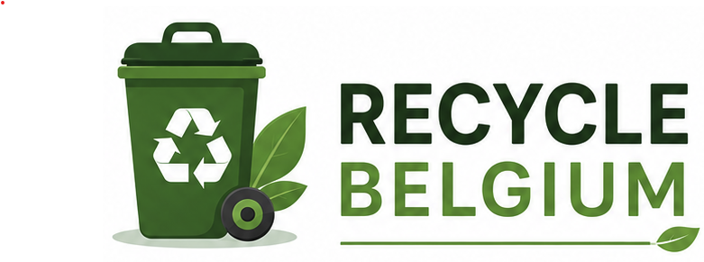
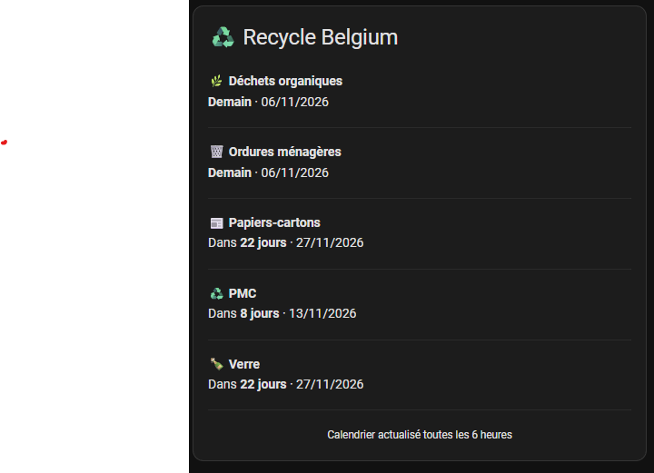

# ♻️ Recycle Belgium

**A Home Assistant integration for Belgian waste collection calendars.**



[](https://hacs.xyz/)
[](https://github.com/patrickalin/recycle_belgium/releases)
[](https://github.com/patrickalin/recycle_belgium/releases)
[](LICENSE)
[](https://www.home-assistant.io/)

[](https://my.home-assistant.io/redirect/hacs_repository/?owner=patrickalin&repository=recycle_belgium&category=integration)

A custom integration for [Home Assistant](https://www.home-assistant.io/) that retrieves Belgian waste collection dates using the public Recycle! / Fost Plus API.

Configure your Belgian address once and get your next collection dates directly in Home Assistant.

---

## ✨ Features

- 🇧🇪 Belgian waste collection calendar.
- Automatic address validation using postal code, street and house number.
- Five collection sensors:
  - Organic waste
  - Residual waste / household waste
  - Paper and cardboard
  - PMC / PMD
  - Glass
- Automatic data refresh every 6 hours.
- Upcoming collection dates available as sensor attributes.
- Supports addresses where some waste categories are not collected.
- Native Home Assistant configuration flow.
- No API key required.

## 📸 Dashboard example

Add a Markdown card to your Home Assistant dashboard to display your upcoming collections.



## 📦 Installation

### HACS (recommended)

1. Open HACS in Home Assistant.
2. Open the three-dot menu.
3. Select **Custom repositories**.
4. Add this repository:

   `https://github.com/patrickalin/recycle_belgium`

5. Select **Integration** as the category.
6. Click **Add**.
7. Search for **Recycle Belgium** and install it.
8. Restart Home Assistant.

You can also use the **Open in HACS** button at the top of this page after adding the custom repository.

### Manual installation

1. Download the latest release.
2. Extract the archive.
3. Copy the `custom_components/recycle_belgium` directory into your Home Assistant `custom_components` directory.

Your configuration should look like this:

```text
config/
└── custom_components/
    └── recycle_belgium/
        ├── __init__.py
        ├── api.py
        ├── config_flow.py
        ├── const.py
        ├── manifest.json
        ├── sensor.py
        ├── translations/
        └── brand/
```

4. Restart Home Assistant.

## ⚙️ Configuration

After installation:

1. Go to **Settings → Devices & services**.
2. Click **Add integration**.
3. Search for **Recycle Belgium**.
4. Enter your Belgian address.

The integration requires:

| Field | Example |
|---|---|
| Postal code | `6000` |
| Street | `Grand rue` |
| House number | `1` |

The street name must match the name recognized by the Recycle! service.

The integration validates the address before saving it. It does not guess street names.

## 📊 Sensors

The integration creates up to five sensors:

| Sensor | Description |
|---|---|
| Organic waste | Next organic waste collection |
| Residual waste | Next household waste collection |
| Paper and cardboard | Next paper and cardboard collection |
| PMC | Next PMC collection |
| Glass | Next glass collection |

Each sensor provides:

- Its next collection date as its state.
- An `upcoming_dates` attribute containing future collection dates.

Collection categories that do not exist for an address have no upcoming date.

The integration ignores events that are not actual collections and collections replaced by an exception.

## 🖼️ Dashboard card

You can use the native Home Assistant Markdown card to display the next collection for each category.

Go to:

**Dashboard → Edit dashboard → Add card → Manual**

Paste the following YAML.

> Important: Replace the entity IDs below with the actual entity IDs created by your Home Assistant installation.

```yaml






**{{ icon }} {{ name }}**  
**Aujourd'hui****Demain**Dans **{{ days }} jours****Collecte passée** · {{ collection.strftime('%d/%m/%Y') }}

---


<center><small>Calendrier actualisé toutes les 6 heures</small></center>

```

### Dashboard customization

You can customize the Markdown card to match your Home Assistant dashboard:

- Change the icons.
- Change the collection labels.
- Use different colors or formatting.
- Add upcoming collection dates using the `upcoming_dates` sensor attribute.

## 🔄 Data updates

The integration uses the public Recycle! / Fost Plus API.

- Data is retrieved asynchronously.
- The update interval is 6 hours.
- The integration requests a collection horizon of 365 days.
- Dates are interpreted using the calendar date returned by the API.

No API key or account is required.

## 🛠️ Troubleshooting

### The integration does not appear

- Check that the integration is installed in `custom_components/recycle_belgium`.
- Restart Home Assistant.
- Clear the browser cache if necessary.

### The address cannot be validated

- Check your postal code.
- Use the official street name.
- Check the house number.
- Make sure the address is supported by Recycle!.

### A sensor has no date

Some waste categories are not collected in every municipality or at every address.

A sensor without a future collection date may therefore be expected.

### Logs

Check Home Assistant logs for errors related to:

`custom_components.recycle_belgium`

## 🧑‍💻 Development

The integration is written in Python and uses Home Assistant's asynchronous architecture.

Main files:

| File | Purpose |
|---|---|
| `api.py` | Recycle! API client |
| `config_flow.py` | Address configuration |
| `const.py` | Constants and settings |
| `__init__.py` | Integration setup and coordinator |
| `sensor.py` | Collection sensors |
| `manifest.json` | Integration metadata |

## 📋 Requirements

- Home Assistant
- HACS (optional, recommended)
- Internet access to the Recycle! API

## ❤️ Credits

Collection data is provided by the public Recycle! service operated by Fost Plus.

Home Assistant integration developed by **Alin.be**.

## 🐛 Issues and feature requests

If you encounter a problem or have a suggestion, please open an issue:

[Report an issue](https://github.com/patrickalin/recycle_belgium/issues)

## 📄 License

See [LICENSE](LICENSE).

